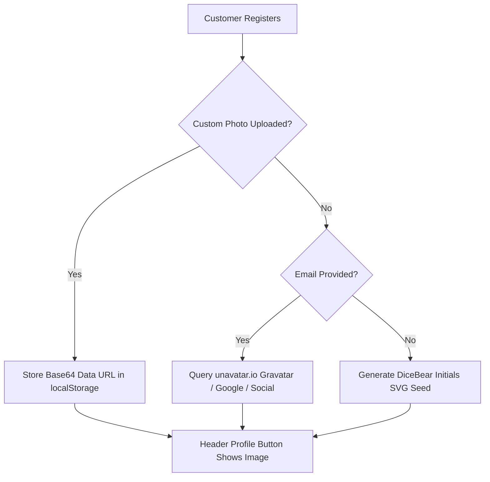

# 🛠️ MIDEVA'S COLLECTION — DEVELOPER & ENGINEERING HANDBOOK
### *Technical Architecture, Browser Automation, Design Patterns & Cloud Migration Guide*
**Platform:** Mideva's Collection (`midevas-collection.vercel.app`)  
**Version:** 3.2.0 | **Author:** Engineering Pair Programming Team  
**Updated:** 19 October 2026 | **Runtime:** Node.js 18+ / React 18.3.1 / Vite 5.4.14  

---

## 1. Executive Engineering Summary

Mideva's Collection is a high-performance, **zero-cost campus e-commerce and WhatsApp commerce engine** built for sub-Saharan tertiary environments. It demonstrates how modern web primitives (Vite, React 18, Tailwind CSS, HTML5 Canvas, Service Workers) can deliver an Amazon-grade shopping experience with instant WhatsApp ordering, real-time multi-currency conversions, and comprehensive administrative controls at **$0.00/month operational infrastructure costs**.

---

## 2. Directory Tree & Codebase Layout

```
D:\Projects\midevas-collection\
├── api\
│   └── whatsapp-webhook.js             # Vercel serverless edge webhook for Meta WhatsApp Cloud API
├── public\
│   ├── favicon.svg                     # Lightweight brand SVG icon
│   ├── manifest.json                   # PWA web application manifest
│   └── sw.js                           # Progressive Web App Service Worker (stale-while-revalidate)
├── src\
│   ├── components\
│   │   ├── AdminModal.jsx              # Full-width store management workspace (8 tabs, 2900+ lines)
│   │   ├── AmazonSidebarNav.jsx        # Amazon-style slide-out department navigation drawer
│   │   ├── AnnouncementBar.jsx         # Edge-to-edge scrolling dynamic marquee ticker
│   │   ├── AuthModal.jsx               # Comrade customer registration with live email photo preview
│   │   ├── CategoryPills.jsx           # Department category filters with counts & price filters
│   │   ├── ChatWidget.jsx              # Floating campus assistant chatbot
│   │   ├── FlyerGeneratorModal.jsx     # HTML5 Canvas poster creator (9:16 story & 1:1 square)
│   │   ├── Footer.jsx                  # Edge-to-edge responsive site footer with admin trigger
│   │   ├── HeroBanner.jsx              # Full-bleed 4-slide promotional banner with gradient scrims
│   │   ├── MobileBottomBar.jsx         # Sticky bottom navigation bar for mobile smartphones
│   │   ├── Navbar.jsx                  # Header with search, currency, theme toggle, and cart
│   │   ├── PaymentModal.jsx            # Express checkout modal (M-Pesa STK push & EcoCash USSD)
│   │   ├── ProductCard.jsx             # Product card with like heart, deal badge & quick view
│   │   ├── ProductDetailModal.jsx      # Amazon-style detail modal with variant selector & reviews
│   │   ├── ProductGrid.jsx             # Responsive CSS grid for catalog display
│   │   ├── QuoteDrawer.jsx             # Slide-out quote cart & WhatsApp message generator
│   │   ├── ReviewsModal.jsx            # Customer testimonials viewer & review submission form
│   │   ├── ToastNotification.jsx       # Floating notification alert system
│   │   ├── UserProfileDropdown.jsx     # Header profile button with avatar & RBAC role badge
│   │   └── WhatsAppFloat.jsx           # Floating quick-order WhatsApp button
│   ├── data\
│   │   └── products.js                 # 52 BASELINE_PRODUCTS, 9 categories, & CRUD storage helpers
│   ├── utils\
│   │   ├── analytics.js                # Event logger for page views, quotes, and catalog searches
│   │   ├── customerAuth.js             # Customer registration, profile storage & avatar resolution
│   │   ├── likes.js                    # Product like counts & toggle helpers
│   │   ├── notifications.js            # Global toast dispatch system
│   │   ├── orders.js                   # Order tracking, status transitions & delivery rosters
│   │   ├── rbac.js                     # Role-Based Access Control matrix & permissions
│   │   ├── storeConfig.js              # Multi-currency conversion engine (USD, KSh, EcoCash)
│   │   ├── theme.js                    # Dark/light mode theme toggler with persistence
│   │   └── whatsappAgentEngine.js      # Natural-language keyword-intent AI parser
│   ├── App.jsx                         # Root orchestrator & hash-based routing coordinator
│   ├── index.css                       # Tailwind directives & custom CSS animations
│   └── main.jsx                        # React 18 DOM mount point
├── test-rbac-and-layout.mjs            # Puppeteer E2E automated layout & RBAC verification
├── take-all-handover-screenshots.mjs   # Complete 17-screenshot automated capture suite
├── vercel.json                         # Vercel deployment configuration & edge routing
├── package.json                        # Dependencies and build scripts
└── vite.config.js                      # Vite bundler configuration
```

---

## 3. Core Software Engineering Techniques

### 3.1 Browser Automation with Puppeteer (`puppeteer-core`)
Instead of downloading heavy 300MB Chromium binaries in CI/CD or local machines, the project utilizes `puppeteer-core` bound to the developer's installed Google Chrome instance:

```javascript
// Example from test-rbac-and-layout.mjs
import puppeteer from 'puppeteer-core';

const CHROME_PATH = 'C:\\Program Files\\Google\\Chrome\\Application\\chrome.exe';

const browser = await puppeteer.launch({
  executablePath: CHROME_PATH,
  headless: 'new',
  args: ['--no-sandbox', '--disable-setuid-sandbox', '--window-size=1600,980']
});
```

#### Key Automation Techniques Used:
1. **Zero Console Errors Validation:**
   ```javascript
   const consoleErrors = [];
   page.on('console', msg => {
     if (msg.type() === 'error') consoleErrors.push(msg.text());
   });
   page.on('pageerror', err => consoleErrors.push(err.toString()));
   ```
2. **Sub-Pixel DOM Layout Verification:**
   Validating that content starts at the farthest ends (< 24px margin from window edge):
   ```javascript
   const metrics = await page.evaluate(() => {
     const header = document.querySelector('header');
     const catalog = document.getElementById('catalog');
     return {
       headerWidth: header ? header.getBoundingClientRect().width : null,
       catalogLeft: catalog ? catalog.getBoundingClientRect().left : null,
     };
   });
   console.assert(metrics.catalogLeft <= 24, 'Catalog must start from the far left margin');
   ```
3. **Role-Based State Injection:**
   Simulating different user roles (Guest, Customer, Seller, Admin) programmatically via `page.evaluate()` without needing manual form submissions:
   ```javascript
   await page.evaluate(() => {
     localStorage.setItem('midevas_auth_user', JSON.stringify({
       role: 'admin',
       name: 'Mona Lisa Mideva',
       email: 'monalisamideva@gmail.com',
       passcode: 'mideva2026'
     }));
     sessionStorage.setItem('midevas_admin_auth', 'true');
     window.location.hash = '#admin';
   });
   await page.reload({ waitUntil: 'networkidle0' });
   ```

---

### 3.2 Single-Page Hash Routing (`#store` vs `#admin`)
To guarantee seamless, instant transitions without server-side routing overhead or 404 errors on static hosts, the application implements window hash synchronization:

```javascript
// src/App.jsx
const [currentView, setCurrentView] = useState(() => {
  if (typeof window !== 'undefined' && window.location.hash === '#admin') return 'admin';
  return 'store';
});

useEffect(() => {
  const handleHashSync = () => {
    if (window.location.hash === '#admin') setCurrentView('admin');
    else setCurrentView('store');
  };
  window.addEventListener('hashchange', handleHashSync);
  return () => window.removeEventListener('hashchange', handleHashSync);
}, []);
```
When an authenticated admin clicks *"Switch to Storefront"*, `window.location.hash = '#store'` seamlessly mounts the public shopping view while preserving the active admin session!

---

### 3.3 Event-Driven Decoupled Component Architecture
To avoid prop-drilling or bulky external state libraries, components communicate across DOM trees via native custom events:

| Custom Event Name | Dispatched When | Subscribed By |
|:---|:---|:---|
| `midevas-catalog-updated` | Admin adds/edits/deletes product or stock | `App.jsx` re-renders `ProductGrid` |
| `midevas-auth-updated` | User signs in, registers, switches role, or logs out | `Navbar`, `UserProfileDropdown` update avatar |
| `midevas-customer-updated` | Comrade updates hostel room or phone number | `AuthModal`, `QuoteDrawer` pre-fill forms |
| `midevas-theme-changed` | User toggles Light/Dark mode | Global HTML `dark` class sync |
| `midevas-toast-event` | Any action triggers a notification | `ToastNotification.jsx` renders toast alert |

---

### 3.4 Dynamic Avatar Resolution Chain
To ensure every registered customer has an immediate visual photo in the header bar without mandatory file hosting, `customerAuth.js` implements a 3-tier avatar resolver:



```javascript
// src/utils/customerAuth.js
export function resolveEmailAvatar(email, name) {
  const cleanEmail = email ? email.trim().toLowerCase() : '';
  const cleanName = name ? name.trim() : 'Comrade';
  if (cleanEmail) {
    return `https://unavatar.io/${encodeURIComponent(cleanEmail)}?fallback=https://api.dicebear.com/7.x/initials/svg?seed=${encodeURIComponent(cleanName)}`;
  }
  return `https://api.dicebear.com/7.x/initials/svg?seed=${encodeURIComponent(cleanName)}`;
}
```

---

### 3.5 Automated Boot Sanitizer for Zero Artifact Leakage
To ensure that developer test accounts or stale client-side caches are permanently purged on end-user devices, an automated sanitizer runs on application initialization:

```javascript
// Executed in App.jsx and rbac.js on every mount
try {
  const authRaw = localStorage.getItem('midevas_auth_user');
  if (authRaw && (authRaw.toLowerCase().includes('brian') || authRaw.toLowerCase().includes('lupao'))) {
    localStorage.removeItem('midevas_auth_user');
    sessionStorage.removeItem('midevas_admin_auth');
  }
  const custRaw = localStorage.getItem('midevas_customer_user');
  if (custRaw && (custRaw.toLowerCase().includes('brian') || custRaw.toLowerCase().includes('lupao'))) {
    localStorage.removeItem('midevas_customer_user');
  }
} catch (e) {}
```

---

### 3.6 Multi-Currency Engine (`formatPrice`)
The platform supports real-time dual-currency rendering across USD, KSh, and EcoCash:

```javascript
// src/utils/storeConfig.js
export function formatPrice(usdAmount, activeCurrency = '$', config = DEFAULT_STORE_CONFIG) {
  const amount = Number(usdAmount) || 0;
  if (activeCurrency === 'KSh') {
    const kshRate = config?.exchangeRate || 130;
    return `KSh ${Math.round(amount * kshRate).toLocaleString()}`;
  }
  if (activeCurrency === 'EcoCash') {
    if (config?.ecocashMode === 'ZiG') {
      const zigRate = config?.ecocashRate || 28;
      return `ZiG ${Math.round(amount * zigRate).toLocaleString()}`;
    }
    return `EcoCash $${amount.toFixed(2)}`;
  }
  return `$${amount.toFixed(2)}`;
}
```

---

## 4. Serverless Edge Webhook (`api/whatsapp-webhook.js`)

Deployed to Vercel's global edge network, this endpoint handles bidirectional communication with Meta Cloud API:

1. **GET Verification Handshake:**
   ```javascript
   if (mode === 'subscribe' && token === process.env.WHATSAPP_VERIFY_TOKEN) {
     return res.status(200).send(challenge);
   }
   ```
2. **POST Inbound Message Processor:**
   Extracts incoming text messages, executes `processWhatsAppMessage(text)` from `whatsappAgentEngine.js`, and formats outbound replies.
3. **Developer Simulation Mode:**
   Allows testing webhook execution directly with `curl` or Postman:
   ```bash
   curl -X POST https://midevas-collection.vercel.app/api/whatsapp-webhook \
     -H "Content-Type: application/json" \
     -d '{"message": "What deals are under $5?"}'
   ```

---

## 5. Free Cloud Database Migration (PostgreSQL / Supabase)

When the business scales past single-device `localStorage`, execute this complete schema in the [Supabase SQL Editor](https://app.supabase.com):

```sql
-- =========================================================================
-- MIDEVA'S COLLECTION — SUPABASE POSTGRESQL PRODUCTION DDL
-- =========================================================================

-- 1. Enable UUID Extension
CREATE EXTENSION IF NOT EXISTS "uuid-ossp";

-- 2. Products Table
CREATE TABLE public.products (
  id TEXT PRIMARY KEY,
  name TEXT NOT NULL,
  category TEXT NOT NULL,
  price NUMERIC(10,2) NOT NULL,
  comrade_price NUMERIC(10,2),
  badge TEXT,
  is_comrade_deal BOOLEAN DEFAULT false,
  rating NUMERIC(2,1) DEFAULT 5.0,
  reviews INTEGER DEFAULT 0,
  description TEXT,
  sizes TEXT[],
  colors TEXT[],
  scents TEXT[],
  image TEXT,
  in_stock BOOLEAN DEFAULT true,
  stock_quantity INTEGER DEFAULT 20,
  created_at TIMESTAMPTZ DEFAULT NOW(),
  updated_at TIMESTAMPTZ DEFAULT NOW()
);

-- 3. Orders Table
CREATE TABLE public.orders (
  id TEXT PRIMARY KEY,
  customer_name TEXT NOT NULL,
  customer_phone TEXT,
  delivery_location TEXT NOT NULL,
  notes TEXT,
  items JSONB NOT NULL,
  total_usd NUMERIC(10,2) NOT NULL,
  total_ksh INTEGER,
  currency TEXT DEFAULT '$',
  payment_method TEXT DEFAULT 'Cash on Delivery',
  status TEXT DEFAULT 'Pending' CHECK (status IN ('Pending', 'Confirmed', 'Delivered', 'Cancelled')),
  created_at TIMESTAMPTZ DEFAULT NOW()
);

-- 4. Customer Profiles Table
CREATE TABLE public.customers (
  id TEXT PRIMARY KEY DEFAULT gen_random_uuid(),
  name TEXT NOT NULL,
  email TEXT UNIQUE,
  phone TEXT NOT NULL,
  hostel TEXT NOT NULL,
  campus TEXT DEFAULT 'Main Campus',
  avatar TEXT,
  created_at TIMESTAMPTZ DEFAULT NOW()
);

-- 5. Product Reviews Table
CREATE TABLE public.product_reviews (
  id TEXT PRIMARY KEY DEFAULT gen_random_uuid(),
  product_id TEXT REFERENCES public.products(id) ON DELETE CASCADE,
  author TEXT NOT NULL,
  campus TEXT,
  rating INTEGER CHECK (rating >= 1 AND rating <= 5),
  comment TEXT NOT NULL,
  created_at TIMESTAMPTZ DEFAULT NOW()
);

-- 6. Store Configuration Table
CREATE TABLE public.store_config (
  key TEXT PRIMARY KEY,
  value JSONB NOT NULL,
  updated_at TIMESTAMPTZ DEFAULT NOW()
);

-- Enable Row Level Security (RLS)
ALTER TABLE public.products ENABLE ROW LEVEL SECURITY;
ALTER TABLE public.orders ENABLE ROW LEVEL SECURITY;
ALTER TABLE public.customers ENABLE ROW LEVEL SECURITY;
ALTER TABLE public.product_reviews ENABLE ROW LEVEL SECURITY;
ALTER TABLE public.store_config ENABLE ROW LEVEL SECURITY;

-- Public Read Policies
CREATE POLICY "Allow public read on products" ON public.products FOR SELECT USING (true);
CREATE POLICY "Allow public read on reviews" ON public.product_reviews FOR SELECT USING (true);
CREATE POLICY "Allow public read on config" ON public.store_config FOR SELECT USING (true);

-- Public Insert Policies
CREATE POLICY "Allow public order creation" ON public.orders FOR INSERT WITH CHECK (true);
CREATE POLICY "Allow customer registration" ON public.customers FOR INSERT WITH CHECK (true);
CREATE POLICY "Allow review creation" ON public.product_reviews FOR INSERT WITH CHECK (true);

-- Authenticated Staff Admin Modification Policies
CREATE POLICY "Allow staff product modifications" ON public.products FOR ALL USING (auth.role() = 'authenticated');
CREATE POLICY "Allow staff order modifications" ON public.orders FOR ALL USING (auth.role() = 'authenticated');
CREATE POLICY "Allow staff config modifications" ON public.store_config FOR ALL USING (auth.role() = 'authenticated');
```

---

## 6. Build, Test & Verification Scripts

```bash
# 1. Start local Vite development server
npm run dev

# 2. Compile production build
npm run build

# 3. Preview production dist build
npm run preview

# 4. Execute automated Puppeteer layout & RBAC verification
node test-rbac-and-layout.mjs

# 5. Capture all 17 navigation screenshots
node take-all-handover-screenshots.mjs

# 6. Run standalone WhatsApp QR pairing agent
npm run bot
```

---

*Mideva's Collection Developer Guide — Engineering Architecture Document MC-DEV-3.2*
