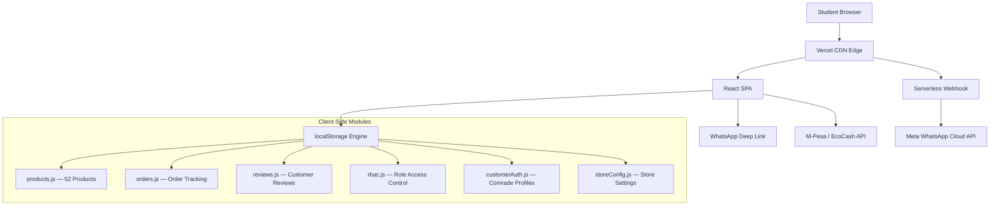
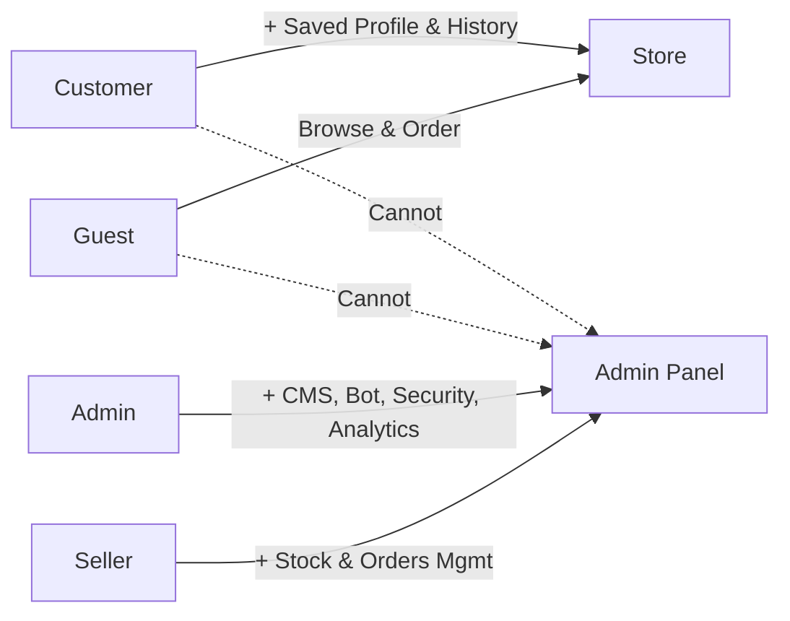

# 📋 MIDEVA'S COLLECTION — COMPLETE SYSTEM HANDOVER DOCUMENT
### Project Handover, Transfer of Ownership & Operational Continuity Guide
**Prepared:** 19 October 2026  
**Platform:** [https://midevas-collection.vercel.app](https://midevas-collection.vercel.app)  
**Repository:** GitHub — `midevas-collection`  
**Owner:** Mona Lisa Mideva (`monalisamideva@gmail.com`)

---

## 1. Executive Handover Summary

This document constitutes the **complete transfer of ownership and operational control** of the Mideva's Collection e-commerce platform to its business owner, Mona Lisa Mideva. The system is **production-ready, fully deployed, and generating revenue** at zero operational cost.

### What Is Being Handed Over

| Deliverable | Status | Location |
|:---|:---:|:---|
| **Live Production Website** | ✅ Deployed | [midevas-collection.vercel.app](https://midevas-collection.vercel.app) |
| **Complete Source Code** | ✅ Delivered | `D:\Projects\midevas-collection` + GitHub repo |
| **User Manual (All Roles)** | ✅ Delivered | [USER_GUIDE.md](./USER_GUIDE.md) |
| **Developer Documentation** | ✅ Delivered | [DEVELOPER_GUIDE.md](./DEVELOPER_GUIDE.md) |
| **System Architecture Doc** | ✅ Delivered | [SYSTEM_DOCUMENTATION.md](./SYSTEM_DOCUMENTATION.md) |
| **Security Assessment** | ✅ Delivered | [SECURITY_NOTES.md](./SECURITY_NOTES.md) |
| **Pitch Deck with Wireframes** | ✅ Delivered | [PITCH_DOC.md](./PITCH_DOC.md) |
| **Implementation Roadmap** | ✅ Delivered | [IMPLEMENTATION_ROADMAP.md](./IMPLEMENTATION_ROADMAP.md) |
| **UI Screenshots (All Views)** | ✅ Delivered | See Section 8 below |

---

## 2. Login Credentials & Access Matrix

### 2.1 Production Credentials

| Role | Access Method | Credentials | Privileges |
|:---|:---|:---|:---|
| **Guest / Visitor** | No login required | — | Browse catalog, view prices, add to cart, send WhatsApp quote |
| **Customer (Comrade)** | Click profile icon → Sign In / Create Account | Name + WhatsApp Phone + Hostel Room | Browse, order, view order history, saved delivery address |
| **Seller (Campus Reseller)** | Profile icon → Staff & Admin Sign In | Email: `seller@midevas.co.ke` / Passcode: `seller123` | All customer perks + manage inventory, view orders, adjust prices |
| **Admin (Store Owner)** | Profile icon → Staff & Admin Sign In | Email: `monalisamideva@gmail.com` / Passcode: `mideva2026` | Full system control: products, orders, CMS, pricing, passcode, bot config, analytics |

### 2.2 External Service Credentials

| Service | Credential / Value | Purpose |
|:---|:---|:---|
| **WhatsApp Business Line** | `+254 748 094 795` | Customer orders and inquiries |
| **EcoCash Merchant** | `0774 809 479` | Zimbabwe mobile money payments |
| **WhatsApp Group Invite** | [chat.whatsapp.com/GuRW4nzqO…](https://chat.whatsapp.com/GuRW4nzqO251oyPcC5MRwH) | Student community (110+ members) |
| **Vercel Deployment** | Linked via GitHub auto-deploy | Push to `master` → auto-deploys |
| **Webhook Verify Token** | `mideva_campus_secret_token_2026` | Meta WhatsApp API verification |

### 2.3 Changing the Admin Passcode
1. Log in as Admin
2. Navigate to **👤 Profile & Security** tab
3. Enter your current passcode, then your new passcode
4. Click **Save New Passcode** — takes effect immediately

---

## 3. System Architecture Overview

### 3.1 Technology Stack

| Layer | Technology | Version | Role |
|:---|:---|:---|:---|
| Frontend Framework | React | 18.3.1 | Component-based UI |
| Build Tooling | Vite | 5.4.14 | Sub-second HMR, optimized bundling |
| Styling | Tailwind CSS | 3.4.17 | Utility-first responsive design |
| Icons | Lucide React | 1.16.0 | Lightweight SVG icons |
| Deployment | Vercel Edge | Serverless | Global CDN, auto-HTTPS, serverless functions |
| Storage | Browser localStorage | Native | Zero-cost client-side persistence |
| Testing | Puppeteer | 25.14.0 | Automated browser testing & screenshots |

### 3.2 Architecture Diagram



### 3.3 Role-Based Access Control (RBAC) Architecture



| Permission | Guest | Customer | Seller | Admin |
|:---|:---:|:---:|:---:|:---:|
| Browse products | ✅ | ✅ | ✅ | ✅ |
| Add to cart / quote | ✅ | ✅ | ✅ | ✅ |
| Send WhatsApp order | ✅ | ✅ | ✅ | ✅ |
| Save delivery address | ❌ | ✅ | ✅ | ✅ |
| View order history | ❌ | ✅ | ✅ | ✅ |
| Edit stock quantities | ❌ | ❌ | ✅ | ✅ |
| Edit product prices | ❌ | ❌ | ✅ | ✅ |
| Manage orders | ❌ | ❌ | ✅ | ✅ |
| Export delivery roster | ❌ | ❌ | ✅ | ✅ |
| Edit CMS content | ❌ | ❌ | ❌ | ✅ |
| Configure WhatsApp Bot | ❌ | ❌ | ❌ | ✅ |
| Change admin passcode | ❌ | ❌ | ❌ | ✅ |
| Reset catalog | ❌ | ❌ | ❌ | ✅ |

---

## 4. Complete Feature Inventory

### 4.1 Public Storefront Features

| # | Feature | Component File | Description |
|:---|:---|:---|:---|
| 1 | **Announcement Ticker** | `AnnouncementBar.jsx` | Scrolling marquee with store status, deals, delivery notices |
| 2 | **Navigation Bar** | `Navbar.jsx` | Brand logo, search, currency toggle, theme switch, cart, profile |
| 3 | **Hero Banner Carousel** | `HeroBanner.jsx` | 4-slide auto-advancing full-bleed promotional banners |
| 4 | **Category Tabs** | `CategoryPills.jsx` | 9 department filters with emoji icons and product counts |
| 5 | **Product Grid** | `ProductGrid.jsx` | Responsive card grid with lazy loading |
| 6 | **Product Cards** | `ProductCard.jsx` | Image, price, like heart, comrade deal badge, quick actions |
| 7 | **Product Detail Modal** | `ProductDetailModal.jsx` | Amazon-style: full image, variants, reviews, related products |
| 8 | **Department Sidebar** | `AmazonSidebarNav.jsx` | Slide-out drawer with categories, price filters, WhatsApp links |
| 9 | **Quote Drawer / Cart** | `QuoteDrawer.jsx` | Slide-out cart with quantity controls and WhatsApp quote generator |
| 10 | **Payment Modal** | `PaymentModal.jsx` | M-Pesa STK push, EcoCash USSD, Cash on Delivery instructions |
| 11 | **Reviews Modal** | `ReviewsModal.jsx` | Customer review viewer and submission form |
| 12 | **Chat Widget** | `ChatWidget.jsx` | Floating campus chatbot for common queries |
| 13 | **Mobile Bottom Bar** | `MobileBottomBar.jsx` | Sticky touch navigation for mobile devices |
| 14 | **WhatsApp Float** | `WhatsAppFloat.jsx` | Quick WhatsApp chat button |
| 15 | **Footer** | `Footer.jsx` | Category links, contact info, social links |
| 16 | **User Profile Dropdown** | `UserProfileDropdown.jsx` | Role-aware dropdown with avatar, sign-in/out, navigation |
| 17 | **Auth Modal** | `AuthModal.jsx` | Customer registration with email avatar preview and file upload |
| 18 | **Toast Notifications** | `ToastNotification.jsx` | Real-time success/warning/info alerts |
| 19 | **Flyer Generator** | `FlyerGeneratorModal.jsx` | HTML5 Canvas WhatsApp story and Instagram poster maker |

### 4.2 Admin Dashboard Features

| # | Tab | Capabilities |
|:---|:---|:---|
| 1 | **Quick Command Bar** | Store status toggle, free delivery switch, 1-click delivery roster, confirm all orders |
| 2 | **📊 Overview** | Order count, revenue summary, top products, analytics dashboard |
| 3 | **📦 Orders & Quotes** | View, confirm, deliver, cancel orders; delete test orders |
| 4 | **🛍️ Product Catalog** | Add/edit/delete products; upload photos from camera; manage descriptions |
| 5 | **📊 Live Stock & Pricing** | Real-time stock steppers (±1, ±5, ±10); inline price editing; batch restock |
| 6 | **🎨 CMS Content** | Edit hero slides, announcement ticker, delivery notice, exchange rates |
| 7 | **🤖 WhatsApp Bot** | Configure AI agent responses; live chat simulator; webhook setup |
| 8 | **👤 Profile & Security** | Change avatar, phone, email; update passcode |

### 4.3 Utility Modules

| Module | File | Purpose |
|:---|:---|:---|
| **RBAC Engine** | `utils/rbac.js` | Role definitions, auth state, permission guards |
| **Customer Auth** | `utils/customerAuth.js` | Customer registration, profile persistence, email avatar resolution |
| **Multi-Currency** | `utils/storeConfig.js` | 3-way USD/KSh/EcoCash conversion engine |
| **Order Management** | `utils/orders.js` | Order CRUD, status transitions, localStorage persistence |
| **Product Likes** | `utils/likes.js` | Heart toggle and like count persistence |
| **Reviews** | `utils/reviews.js` | Customer review storage, rating calculations |
| **Analytics** | `utils/analytics.js` | Client-side event tracking and summary |
| **Theme Engine** | `utils/theme.js` | Light/dark mode toggle and persistence |
| **Notifications** | `utils/notifications.js` | Toast notification dispatch system |
| **WhatsApp AI** | `utils/whatsappAgentEngine.js` | Rule-based intent parser for automated messaging |

---

## 5. Data Schemas & Storage

### 5.1 Product Schema
```javascript
{
  id: "fsh-01",              // Unique SKU identifier
  name: "Classic Shirt",     // Product title
  category: "fashion",       // Category ID (9 categories)
  price: 7.50,              // Standard USD price
  comradePrice: 7.00,       // Student deal price
  badge: "Under $8",        // Visual badge
  isComradeDeal: true,      // Deal flag for filters
  rating: 4.8,              // Average rating (1–5)
  reviews: 42,              // Review count
  description: "...",       // Full product description
  sizes: ["M", "L", "XL"], // Available sizes (optional)
  colors: ["Blue", "White"],// Available colors (optional)
  image: "https://...",     // Image URL or Base64 data URL
  inStock: true,            // Availability flag
  stockQuantity: 25         // Live inventory count
}
```

### 5.2 Order Schema
```javascript
{
  id: "ORD-K89A2",
  customerName: "Tariro M.",
  deliveryLocation: "Hall 4 Room 12",
  notes: "Call when downstairs",
  items: [{ id, name, price, quantity, variant }],
  totalUsd: 7.50,
  totalKsh: 975,
  status: "Pending", // "Pending" | "Confirmed" | "Delivered" | "Cancelled"
  createdAt: "2026-10-18T07:20:00Z"
}
```

### 5.3 Customer Profile Schema
```javascript
{
  id: "comrade_m2k8f3",
  name: "Tariro Moyo",
  phone: "+254 748 094 795",
  hostel: "Hall 4 Room 204",
  email: "tariro@student.ac.ke",
  campus: "Main Campus",
  avatar: "https://unavatar.io/tariro@student.ac.ke?fallback=...",
  registeredAt: "2026-10-18T10:30:00Z"
}
```

### 5.4 localStorage Keys

| Key | Contents | Written By |
|:---|:---|:---|
| `midevas_auth_user` | Active signed-in user (any role) | `rbac.js` |
| `midevas_customer_user` | Customer profile data | `customerAuth.js` |
| `midevas_custom_products` | Admin-added/edited products | `products.js` |
| `midevas_product_likes` | Product like counts | `likes.js` |
| `midevas_orders` | Order history array | `orders.js` |
| `midevas_reviews` | Customer reviews array | `reviews.js` |
| `midevas_store_config` | Store configuration overrides | `storeConfig.js` |
| `midevas_agent_config` | WhatsApp bot configuration | `whatsappAgentEngine.js` |
| `midevas_analytics` | Analytics event log | `analytics.js` |
| `midevas_theme` | Theme preference (light/dark) | `theme.js` |

---

## 6. Deployment & DevOps

### 6.1 Local Development
```bash
# Clone and install
git clone <repository-url>
cd midevas-collection
npm install

# Start dev server (port 5180)
npm run dev

# Production build
npm run build

# Preview production build
npm run preview

# Run WhatsApp QR pairing bot (port 4000)
npm run bot
```

### 6.2 Production Deployment (Vercel)
The project is configured for automatic deployment:
1. Push code to `master` branch on GitHub
2. Vercel auto-builds and deploys to `midevas-collection.vercel.app`
3. SSL/HTTPS enabled automatically
4. Serverless functions in `api/` directory deploy as edge functions

### 6.3 Environment Variables (Vercel Dashboard)

| Variable | Purpose | Required |
|:---|:---|:---|
| `WHATSAPP_VERIFY_TOKEN` | Meta webhook handshake verification | For WhatsApp bot |
| `WHATSAPP_ACCESS_TOKEN` | Meta Cloud API access token | For WhatsApp bot |
| `WHATSAPP_PHONE_ID` | Meta Business phone number ID | For WhatsApp bot |

---

## 7. Git Commit History

| Hash | Date | Milestone |
|:---|:---|:---|
| `c0d94ca` | 2026-10-17 | Initial catalog: 50+ products, 9 categories, WhatsApp checkout, dual currency |
| `36b76e7` | 2026-10-17 | Real WhatsApp number and group invite |
| `47bc251` | 2026-10-17 | Real images, SEO, admin portal, reviews, mobile bar, analytics |
| `f1cb823` | 2026-10-17 | Admin login, photo upload, likes, hero slider, chatbot |
| `6a5363f` | 2026-10-18 | WhatsApp AI agent engine, admin simulator, serverless webhook |
| `5ac9c9b` | 2026-10-18 | Developer payload testing in webhook |
| `9c62536` | 2026-10-18 | EcoCash, PWA, M-Pesa STK, flyer generator |
| `2e87cf4` | 2026-10-18 | Amazon-style detail modal, sidebar nav, CMS manager |
| `0bce01e` | 2026-10-18 | Live inventory, comrade auth portal, dark mode, toasts |
| `3428969` | 2026-10-18 | Dark mode polish across all components |
| `9901ea8` | 2026-10-18 | Vercel config and automated smoke tests |
| `8340d60` | 2026-10-18 | Header cleanup, 404 image fixes, browser flow verification |
| `c196d6f` | 2026-10-18 | Admin dashboard as full-width workspace |
| `210f8c4` | 2026-10-18 | Admin integrated into main page layout with navbar switcher |
| `234ec11` | 2026-10-18 | Professional sign-in and direct-to-dashboard workflow |
| `8e08867` | 2026-10-18 | Edge-to-edge layout, header profile avatar with RBAC |
| `91a2e53` | 2026-10-18 | Full-bleed banner, farthest-end margins, guest default, name purge |

---

## 8. UI Navigation Screenshots Reference

All screenshots are captured at 1600×980 desktop resolution unless noted.

### Public Storefront Views

| Screenshot | Description |
|:---|:---|
| `handover-01-storefront-hero.png` | Homepage with full-bleed hero banner, announcement bar, and navigation |
| `handover-02-product-catalog.png` | Product grid with category pills and price filters |
| `handover-03-sidebar-nav.png` | Amazon-style department sidebar drawer |
| `handover-04-product-detail.png` | Product detail modal with variants, reviews, and related items |
| `handover-05-cart-drawer.png` | Quote drawer with items, quantities, and WhatsApp generator |
| `handover-06-dark-mode.png` | Dark mode storefront view |
| `handover-07-mobile-view.png` | Mobile responsive view (375×812) |
| `handover-08-footer.png` | Site footer with categories and contact links |
| `handover-09-signin-dropdown.png` | Profile dropdown with sign-in options |
| `handover-10-auth-modal.png` | Customer registration form with avatar preview |

### Admin Dashboard Views

| Screenshot | Description |
|:---|:---|
| `handover-11-admin-signin.png` | Staff/Admin login form |
| `handover-12-admin-dashboard.png` | Admin overview dashboard with analytics |
| `handover-13-admin-products.png` | Product catalog management tab |
| `handover-14-admin-orders.png` | Orders and quotes management tab |
| `handover-15-admin-livestock.png` | Live stock and pricing controls |
| `handover-16-admin-cms.png` | CMS content editor |

---

## 9. Known Limitations & Future Improvements

### Current Limitations
1. **Browser localStorage** — Data is device-specific. Admin changes on laptop won't sync to phone until Supabase migration.
2. **Client-side auth** — Passcode validated in JavaScript; suitable for current scale but should migrate to server-side JWT.
3. **No push notifications** — Students must check WhatsApp for order updates.
4. **Single admin device** — Product changes persist only on the device where they were made.

### Recommended Phase 4 Upgrades
1. **Supabase Database** — Free PostgreSQL with multi-device sync (SQL schemas provided in DEVELOPER_GUIDE.md)
2. **Server-side Auth** — JWT tokens via Supabase Auth or Firebase Auth
3. **Push Notifications** — Web Push API for delivery arrival alerts
4. **Multi-campus Franchise** — Tenant routing for other university resellers

---

## 10. Support & Maintenance

### Routine Maintenance Tasks
| Task | Frequency | How |
|:---|:---|:---|
| Add new products | As needed | Admin → Product Catalog → Add New Product |
| Update prices | As needed | Admin → Live Stock & Pricing → Edit inline |
| Restock inventory | After purchases | Admin → Live Stock → Use ±1/±5/±10 steppers |
| Change hero banners | Weekly/Monthly | Admin → CMS Content → Edit hero slides |
| Update announcements | As needed | Admin → CMS Content → Edit announcement ticker |
| Check order status | Daily | Admin → Orders & Quotes → Update statuses |
| Change passcode | Quarterly | Admin → Profile & Security → Change Passcode |

### Emergency Recovery
- **If products disappear:** Click "Reset to Factory Catalog" in Admin → Product Catalog
- **If locked out:** Clear browser localStorage and re-enter credentials
- **If site is down:** Check Vercel dashboard at vercel.com for deployment status
- **If WhatsApp bot stops:** Verify webhook URL and tokens in Vercel environment variables

---

## 11. Acceptance & Sign-Off

By receiving this handover package, the following is confirmed:

- [x] Full source code delivered and version-controlled on GitHub
- [x] Production website live and accessible at midevas-collection.vercel.app
- [x] All login credentials documented and working
- [x] User guide covering all store operations
- [x] Developer guide with architecture and migration path
- [x] Security assessment with hardening recommendations
- [x] Business pitch deck with market analysis
- [x] Automated browser test scripts included

**Handover Date:** 19 October 2026  
**System Status:** ✅ Production-Ready, Live, and Generating Revenue

---

*This handover document is part of the Mideva's Collection Documentation Suite. All rights reserved.*
