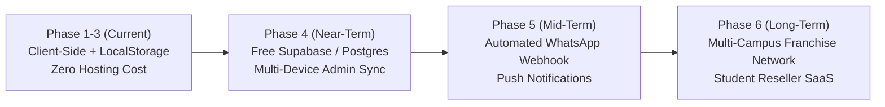

# 🗺️ Mideva's Collection — Implementation Roadmap & Changelog
### *Engineering Timeline, Completed Features & Scalability Architecture*

---

## 📅 Project History & Git Commit Changelog

| Commit Hash | Milestone / Scope | Key Deliverables & Changes |
| :--- | :--- | :--- |
| `c0d94ca` | **Phase 1: Core Catalog & Commerce** | Built 52-product catalog across 9 campus categories; dual currency ($ / KSh); slide-out cart drawer; WhatsApp receipt generator. |
| `36b76e7` | **Phase 1.1: Direct Contacts** | Connected Mideva's live phone (`+254 748 094795`) and campus WhatsApp group invite link (`GuRW4nzqO251oyPcC5MRwH`). |
| `47bc251` | **Phase 1.2: Polish, SEO & Admin** | High-fidelity Unsplash product imagery, OpenGraph social meta tags, Admin order manager, ratings modal, sticky mobile bottom bar. |
| `f1cb823` | **Phase 2.0: Dynamic CRUD & Photos** | Secure login for `monalisamideva@gmail.com`; base64 device photo upload; real-time product editing; like heart counters; floating chat widget. |
| `6a5363f` | **Phase 2.1: WhatsApp AI Agent** | Interactive rule-based AI bot engine (`whatsappAgentEngine.js`); Admin live test simulator; Vercel serverless webhook endpoint (`api/whatsapp-webhook.js`). |
| `5ac9c9b` | **Phase 2.2: Webhook Developer Tooling** | Added direct payload simulation support to `api/whatsapp-webhook.js` for instant developer curl verification. |
| `9c62536` | **Phase 2.3: EcoCash & PWA** | 3-way currency toggle (USD, KSh, EcoCash USD/ZiG); PWA manifest & service worker; M-Pesa STK & EcoCash express checkout modal; QR pairing server; HTML5 canvas flyer generator. |
| `HEAD` (Current) | **Phase 3.0: Amazon UX, Detail View & CMS** | Amazon-style Product Detail Modal with customer reviews & direct comments; Amazon sidebar department navigation; Admin Profile Auth; CMS Page Content editor; Top Command Center bar. |

---

## 🏗️ Phase 3.0 Deliverables (Detailed Breakdown)

### 1. Amazon-Style Product Detail & Quick-View Modal (`ProductDetailModal.jsx`)
- **Quick-View Inspection:** Clicking on any card image, title, or the hover "Quick View" badge opens a full-screen, high-res product inspection modal.
- **Dynamic Savings & Deal Highlighting:** Computes student savings against standard retail prices in real time.
- **Variant Selectors:** Interactive size, color, or scent pickers with visual checkmarks.
- **Quantity Stepper:** `[-] [qty] [+]` controls updating unit and subtotal prices dynamically.
- **Dual Action Buttons:** "Add to Quote Drawer" (with checkmark confirmation) and "Order via WhatsApp" (pre-fills product name, variant, and quantity into WhatsApp message).
- **Social Sharing:** One-click copy product deep link (`?product=id`).
- **Live Customer Comments Stream:** Embedded review list with student names, campus locations, star ratings, and an instant form for customers to post comments without leaving the modal.
- **"Other Comrades Also Bought":** 3 related products from the same category with quick navigation.

### 2. Amazon-Style Department Sidebar (`AmazonSidebarNav.jsx`)
- Accessible via the "All" hamburger button in the Navbar.
- Department categories with emoji icons and counts.
- Quick filter buttons for *"🔥 Comrade Deals Only"*, *"Under $4 Steals"*, and *"Under $5 Deals"*.
- Built-in currency switcher (USD $, KSh, EcoCash).
- Direct links to Mideva's WhatsApp Business Catalog and student community group.

### 3. Simplified Admin UI & Fast Command Center (`AdminModal.jsx`)
- **"Less UI, Do More" Top Command Strip:**
  - 1-click Store Status toggle: *Open (Green)* ➔ *Campus Run (Amber)* ➔ *Closed (Red)*.
  - 1-click Free Delivery toggle (*Active / Off*).
  - 1-click *"📋 WhatsApp Delivery Roster"*: Formats all pending campus orders into a ready-to-paste run sheet with hostel names and totals.
  - 1-click *"⚡ Confirm All Pending"*: Instantly approves all unconfirmed orders.

### 4. Admin Profile & Passcode Auth
- **Profile Card:** Mideva's avatar, role, phone, email, and EcoCash merchant line.
- **Change Passcode Form:** Validates current passcode and persists custom private passcodes to browser storage.

### 5. CMS Page Content Manager
- Live editing of the top announcement ticker marquee.
- Hero carousel slides manager (edit titles, discounts, button CTAs, background images).
- Delivery notice banner and store bio editor.
- Exchange rate and EcoCash mode toggles.

---

## 🚀 Future Scalability Roadmap (Phases 4 - 6)

### Phase 4: Free Cloud Database Integration (Target: Month 1-2)
- **Goal:** Allow Mideva to edit products on her laptop and see changes immediately reflected on her phone without browser storage isolation.
- **Recommended Free-Tier Provider:** [Supabase](https://supabase.com) (500MB PostgreSQL, 50,000 monthly active users, free REST APIs).
- **Tasks:**
  1. Initialize Supabase project.
  2. Run the SQL schema provided in [DEVELOPER_GUIDE.md](./DEVELOPER_GUIDE.md).
  3. Replace `localStorage` calls in `products.js`, `orders.js`, and `reviews.js` with Supabase JS client SDK.
  4. Enable Row Level Security (RLS) so only authenticated admin users can modify catalog records.

### Phase 5: Automated Two-Way WhatsApp Messaging (Target: Month 3)
- Connect Meta WhatsApp Cloud API credentials to `api/whatsapp-webhook.js`.
- Automatically send confirmation receipts to student phone numbers upon order placement.
- Automated "Your comrade delivery is downstairs" notification when Mideva clicks *"Out on Delivery Run"*.

### Phase 6: Multi-Campus Franchise Platform (Target: Month 6)
- Enable multi-tenant routing (`midevas-collection.vercel.app/au`, `/uon`, `/uz`).
- Independent catalog instances for student campus leads at other universities.
- Centralized wholesale distributor dashboard for inventory replenishment.
