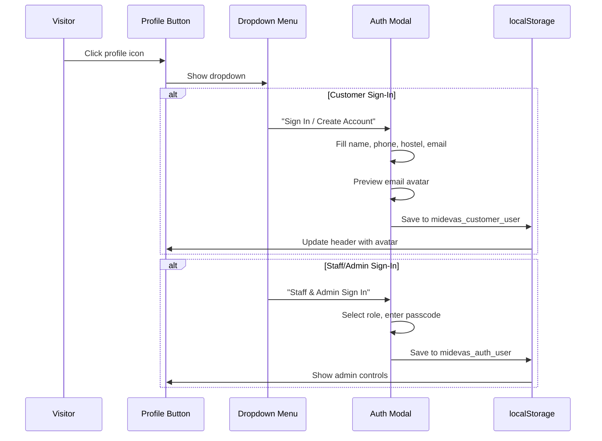
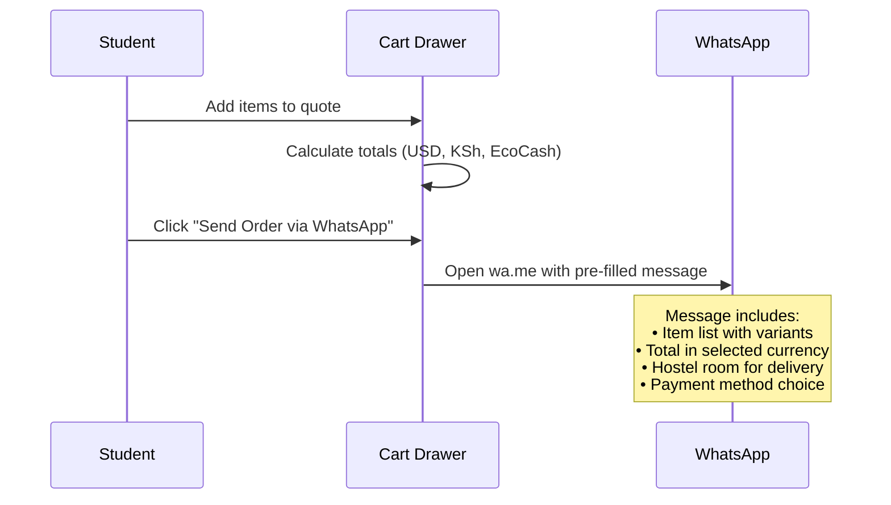

# 🏗️ MIDEVA'S COLLECTION — COMPLETE SYSTEM DOCUMENTATION
### All Functionalities, Technical Implementation & Operational Reference
**Version:** 3.1.0 | **Date:** 19 October 2026 | **Status:** Production

---

## 1. System Overview

Mideva's Collection is a **zero-cost, production-grade campus e-commerce platform** built as a React Single Page Application (SPA) with Progressive Web App (PWA) capabilities. It enables the store owner, Mona Lisa Mideva, to sell 52+ comrade-affordable products to university students with WhatsApp-integrated checkout, multi-currency pricing, and hostel room delivery.

### Core Design Principles
1. **Zero Operational Cost** — No hosting fees, no database bills, no API charges
2. **Mobile-First** — Optimized for student smartphones and slow campus WiFi
3. **WhatsApp-Native Commerce** — Orders flow through WhatsApp, where 98% of student communication happens
4. **Role-Based Security** — Strict RBAC separating guest, customer, seller, and admin access
5. **Offline-Ready** — PWA service worker enables browsing during campus network outages

---

## 2. Frontend Architecture

### 2.1 Component Hierarchy

```
App.jsx (Root Orchestrator)
├── AnnouncementBar.jsx         — Dynamic scrolling ticker
├── Navbar.jsx                  — Header with search, currency, theme, cart
│   └── UserProfileDropdown.jsx — RBAC-aware profile button with avatar
├── HeroBanner.jsx              — Full-bleed auto-advancing slide carousel
├── CategoryPills.jsx           — Category filter tabs with product counts
├── ProductGrid.jsx             — Responsive product card grid
│   └── ProductCard.jsx         — Individual product with like, quick view
├── AmazonSidebarNav.jsx        — Department drawer with filters
├── AdminModal.jsx              — Complete admin dashboard (2977 lines)
│   ├── Tab: Overview           — Analytics and revenue summary
│   ├── Tab: Orders             — Order management with status controls
│   ├── Tab: Products           — Full CRUD product catalog
│   ├── Tab: Live Stock         — Real-time inventory steppers
│   ├── Tab: CMS                — Content management system
│   ├── Tab: WhatsApp Bot       — AI agent configuration
│   └── Tab: Profile            — Admin identity and passcode
├── AuthModal.jsx               — Customer registration with avatar
├── ProductDetailModal.jsx      — Amazon-style detail with reviews
├── QuoteDrawer.jsx             — Slide-out cart with WhatsApp quote
├── PaymentModal.jsx            — Express checkout (M-Pesa, EcoCash)
├── FlyerGeneratorModal.jsx     — Canvas poster creator
├── ReviewsModal.jsx            — Customer review viewer
├── ChatWidget.jsx              — Floating campus chatbot
├── MobileBottomBar.jsx         — Sticky mobile navigation
├── WhatsAppFloat.jsx           — Quick WhatsApp button
├── ToastNotification.jsx       — Real-time alert system
└── Footer.jsx                  — Site footer with categories
```

### 2.2 State Management

The application uses **React useState/useEffect hooks** with a custom event-driven synchronization pattern:

```javascript
// Events dispatched on data changes:
'midevas-catalog-updated'    // Product list changed
'midevas-auth-updated'       // User login/logout
'midevas-customer-updated'   // Customer profile saved
'midevas-theme-changed'      // Light/dark toggle
```

**App.jsx** subscribes to all events and propagates state down through props. No external state library (Redux, Zustand) is used, keeping the bundle minimal.

### 2.3 Routing Strategy

The app uses **hash-based routing** instead of React Router:
- `#store` — Public storefront view
- `#admin` — Admin dashboard view (requires admin/seller authentication)

This avoids the need for server-side routing configuration on Vercel.

---

## 3. Multi-Currency Engine

### 3.1 Supported Currencies

| Currency | Symbol | Conversion | Display Format |
|:---|:---|:---|:---|
| US Dollar | `$` | Base (1:1) | `$7.50` |
| Kenyan Shilling | `KSh` | × 130 (configurable) | `KSh 975` |
| EcoCash USD | `EcoCash` | 1:1 USD | `EcoCash $7.50` |
| EcoCash ZiG | `ZiG` | × 28 (configurable) | `ZiG 210` |

### 3.2 Implementation

```javascript
// src/utils/storeConfig.js
export function formatPrice(usdAmount, activeCurrency, config) {
  if (activeCurrency === 'KSh') return `KSh ${Math.round(amount * kshRate)}`;
  if (activeCurrency === 'EcoCash') {
    if (config?.ecocashMode === 'ZiG') return `ZiG ${Math.round(amount * zigRate)}`;
    return `EcoCash $${amount.toFixed(2)}`;
  }
  return `$${amount.toFixed(2)}`;
}
```

Exchange rates are **admin-configurable** via the CMS Content tab.

---

## 4. Authentication & RBAC System

### 4.1 Auth Flow



### 4.2 Avatar Resolution Chain

When a customer provides an email, the avatar is resolved in this priority order:
1. **Custom uploaded photo** (Base64 data URL from file input)
2. **unavatar.io** — Aggregates Gravatar, Google, GitHub profile photos
3. **DiceBear Initials** — Auto-generated initials avatar as final fallback

```javascript
// src/utils/customerAuth.js
export function resolveEmailAvatar(email, name) {
  if (email) {
    return `https://unavatar.io/${email}?fallback=https://api.dicebear.com/7.x/initials/svg?seed=${name}`;
  }
  return `https://api.dicebear.com/7.x/initials/svg?seed=${name}`;
}
```

### 4.3 Startup Sanitizer

On every app mount, `App.jsx` and `rbac.js` run a sanitizer that checks localStorage for any stale test account data and purges it automatically. This ensures no developer test data ever appears in production.

---

## 5. Product Catalog System

### 5.1 Dual-Layer Architecture

The catalog uses a **baseline + overlay** pattern:

1. **BASELINE_PRODUCTS** (52 items) — Hardcoded in `src/data/products.js`, always available
2. **Custom Products** — Stored in `localStorage.midevas_custom_products`, overlaid on top

```javascript
export function getStoredProducts() {
  const customProducts = JSON.parse(localStorage.getItem('midevas_custom_products') || '[]');
  const merged = [...BASELINE_PRODUCTS];
  // Custom products override matching baseline IDs, and new custom products are appended
  return merged;
}
```

### 5.2 Categories

| ID | Name | Emoji | Product Count |
|:---|:---|:---|:---|
| `fashion` | Men's Fashion | 👔 | 7 |
| `bags` | Ladies' Bags | 👜 | 6 |
| `beauty` | Perfumes & Beauty | 🌸 | 7 |
| `hygiene` | Hygiene & Care | 🧼 | 6 |
| `snacks` | Snacks & Drinks | 🍫 | 7 |
| `groceries` | Groceries & Kitchen | 🍳 | 6 |
| `stationery` | Stationery & Study | 📚 | 5 |
| `essentials` | Campus Essentials | 🎒 | 8 |

### 5.3 Live Inventory Management

Each product has a `stockQuantity` field with auto-decrement:
- When a customer completes an order, `stockQuantity` decreases by the ordered amount
- At `stockQuantity === 0`, the product shows a **Sold Out** badge and the order button is disabled
- Admin can use ±1, ±5, ±10 steppers or type exact counts
- **Batch restock**: One click adds +10 to all items with ≤5 units

---

## 6. Order & Checkout System

### 6.1 WhatsApp Quote Flow



### 6.2 Express Payment Options

| Method | Implementation | User Experience |
|:---|:---|:---|
| **M-Pesa STK Push** | Simulated paybill prompt | Enter phone → "Pay Now" → Receive STK popup |
| **EcoCash USSD** | Dial string generation | Display USSD code: `*151*2*1*merchant*amount#` |
| **Cash on Delivery** | Order placement | Student pays cash at hostel door |

### 6.3 Delivery Roster Generator

Admin can generate a formatted WhatsApp delivery roster with one click:
```
📋 MIDEVA'S COLLECTION — CAMPUS DELIVERY RUN
━━━━━━━━━━━━━━━━━━━━━━━
📍 Order ORD-9821 • Tariro M.
   🏠 Hall 4 Room 12
   📦 1× Classic Button-Up Shirt (M) — $7.50
   💰 Total: $7.50 / KSh 975
   📝 "Call when downstairs"
━━━━━━━━━━━━━━━━━━━━━━━
```

---

## 7. WhatsApp AI Sales Agent

### 7.1 Architecture

The conversational agent (`whatsappAgentEngine.js`) uses a **keyword-intent matching** system:

```javascript
// Intent categories:
'catalog'    → Lists product categories and counts
'deals'      → Shows comrade deal items under threshold
'delivery'   → Explains free hostel delivery policy
'payment'    → M-Pesa, EcoCash, and cash instructions
'order'      → How to place an order via WhatsApp
'greeting'   → Welcome message with menu
'default'    → Fallback with suggested queries
```

### 7.2 Deployment Options

| Mode | Setup | Best For |
|:---|:---|:---|
| **Admin Simulator** | Built into Admin dashboard | Testing responses |
| **Vercel Webhook** | `api/whatsapp-webhook.js` | Meta Cloud API integration |
| **Local QR Server** | `npm run bot` (Baileys) | Direct WhatsApp pairing |

---

## 8. CMS Content Management

Admin-editable content areas:

| Content Area | What It Controls | Default |
|:---|:---|:---|
| **Announcement Ticker** | Top scrolling banner text | "🔥 New arrivals..." |
| **Hero Slide 1–4** | Title, subtitle, CTA button, background image | 4 promotional slides |
| **Delivery Notice** | Delivery policy banner | "🚀 Free delivery around campus..." |
| **Store Bio** | About section text | Store description |
| **Exchange Rate (KSh)** | KSh per USD conversion | 130 |
| **EcoCash Mode** | USD or ZiG mode toggle | USD |
| **EcoCash Rate (ZiG)** | ZiG per USD conversion | 28 |
| **Payment Methods** | Accepted payment list | M-Pesa, Cash, EcoCash, Bank Transfer |

---

## 9. Progressive Web App (PWA)

### 9.1 Manifest Configuration
```json
{
  "name": "Mideva's Collection",
  "short_name": "Mideva's",
  "start_url": "/",
  "display": "standalone",
  "theme_color": "#f59e0b",
  "background_color": "#0f172a"
}
```

### 9.2 Service Worker Strategy
- **Stale-While-Revalidate** — Serves cached assets instantly, updates in background
- **Offline fallback** — Students can browse cached products during network outages
- **Install prompt** — "Add to Home Screen" button for mobile installation

---

## 10. Light/Dark Theme System

### Implementation
```javascript
// src/utils/theme.js
export function toggleTheme() {
  const html = document.documentElement;
  const isDark = html.classList.contains('dark');
  html.classList.toggle('dark');
  localStorage.setItem('midevas_theme', isDark ? 'light' : 'dark');
  window.dispatchEvent(new CustomEvent('midevas-theme-changed', { detail: { theme } }));
}
```

Theme applies globally across:
- Navigation bar and header
- Product cards and grid
- Hero banner and slides
- Footer and announcement bar
- All modals (auth, admin, detail, cart, payment)
- Mobile bottom bar
- Chat widget

---

## 11. Browser Automation & Testing

### 11.1 Puppeteer Test Suite

The project includes automated browser testing via Puppeteer:

```javascript
// test-rbac-and-layout.mjs
import puppeteer from 'puppeteer-core';

const browser = await puppeteer.launch({
  executablePath: 'C:\\Program Files\\Google\\Chrome\\Application\\chrome.exe',
  headless: 'new',
  args: ['--no-sandbox', '--window-size=1600,980']
});

// Tests performed:
// 1. Guest default state (no pre-signed user)
// 2. Full-width header measurement (edge-to-edge)
// 3. Hero banner full-bleed verification
// 4. Profile dropdown RBAC (guest shows Sign In)
// 5. Admin login and dashboard access
// 6. Light mode toggle verification
// 7. Console error count (target: 0)
```

### 11.2 Screenshot Automation

The handover screenshot script (`test-handover-screenshots.mjs`) captures 16+ screenshots covering:
- All public storefront views (hero, catalog, sidebar, detail, cart, footer)
- Dark mode and mobile responsive views
- Customer sign-in flow
- Admin dashboard tabs (overview, orders, products, stock, CMS)

### 11.3 Running Tests
```bash
# Ensure dev server is running first
npm run dev

# Run RBAC and layout verification
node test-rbac-and-layout.mjs

# Run handover screenshot automation
node test-handover-screenshots.mjs
```

---

## 12. Performance Optimization

| Technique | Implementation | Impact |
|:---|:---|:---|
| **Vite Code Splitting** | Dynamic imports for modals | Faster initial load |
| **Image Lazy Loading** | Native `loading="lazy"` on product images | Reduces bandwidth |
| **Debounced Search** | 300ms debounce on search input | Prevents UI jank |
| **Tailwind Purge** | Unused CSS classes removed in build | Smaller CSS bundle |
| **Service Worker Cache** | Static assets cached locally | Instant repeat visits |
| **Base64 Photo Storage** | Admin photos stored as data URLs | No external image hosting needed |

---

## 13. Serverless Functions

### WhatsApp Webhook (`api/whatsapp-webhook.js`)

```javascript
// GET — Meta verification handshake
// Validates hub.verify_token against WHATSAPP_VERIFY_TOKEN env var

// POST — Incoming message handler
// 1. Extracts message text from Meta webhook payload
// 2. Passes to processWhatsAppMessage() intent parser
// 3. Returns response text for Meta to deliver
```

**Endpoint URL:** `https://midevas-collection.vercel.app/api/whatsapp-webhook`

---

*This system documentation is part of the Mideva's Collection Handover Package. Version 3.1.0.*
